# 问津 · 思想栖所

> 当前版本：**3.5.0**（2026-10-24）。版本日志见文末「版本沿革」。

哲学学习应用。电脑端 + 手机端，本地优先，断网可用。

这个仓库是 **v2.1 单文件 HTML 版本的工程化重构**。七个视图在电脑端和手机端跑的是**同一份实现**，两端只保留各自的外壳。

## 界面

电脑端（1440×900）：

| 概念星系 | 方法论库 |
|---|---|
| 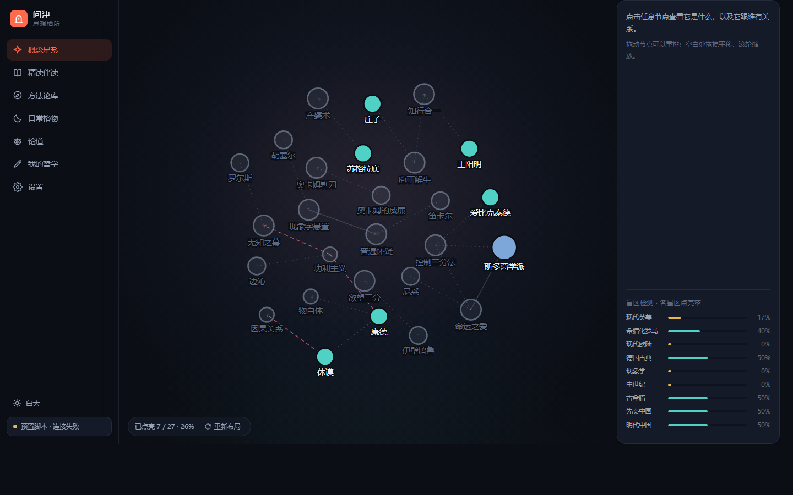 | 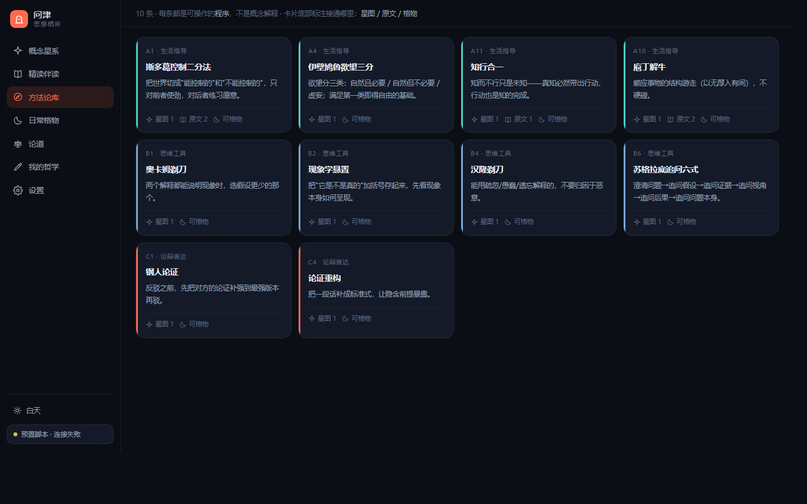 |

| 精读伴读 | 日常格物 |
|---|---|
| 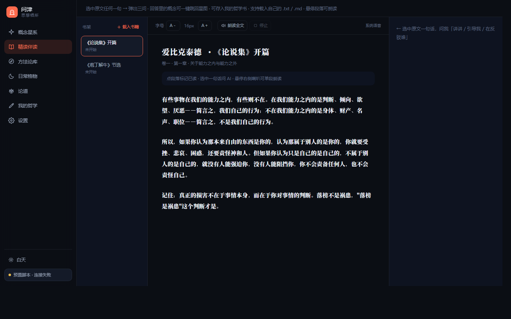 | 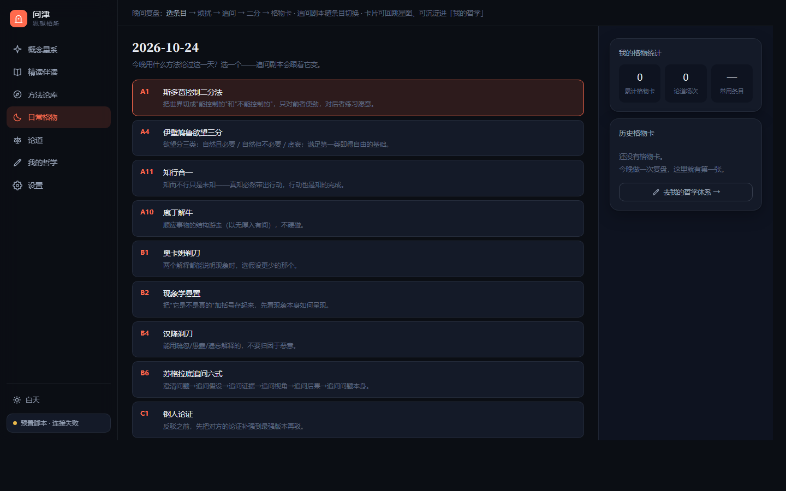 |

| 论道 | 我的哲学 |
|---|---|
| 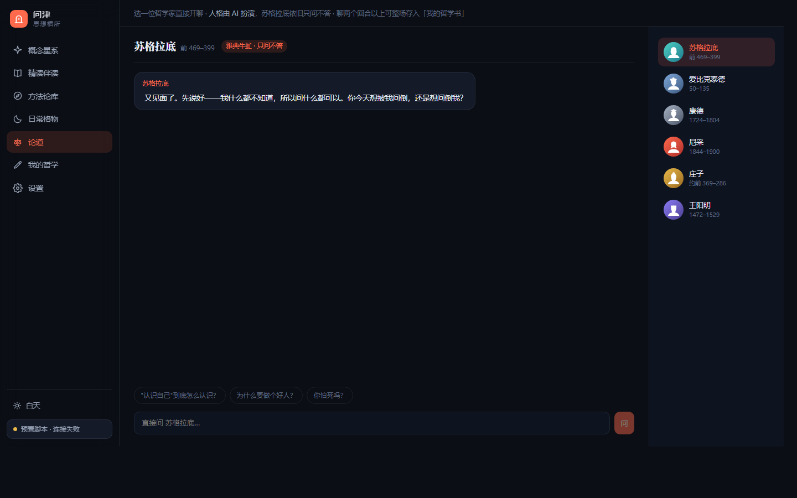 | 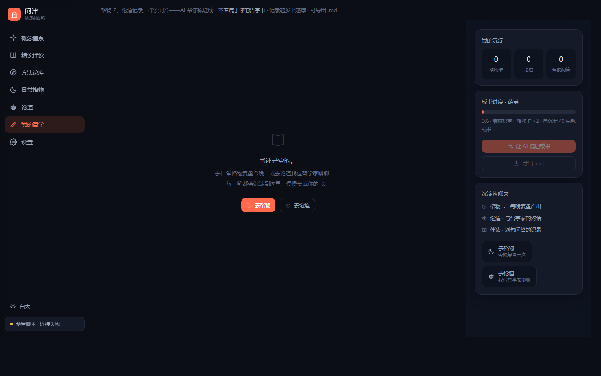 |

手机端（390×844）：

<p>
  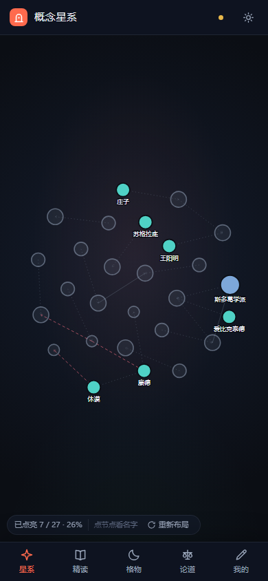
  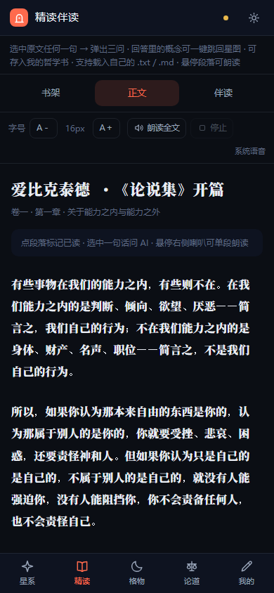
  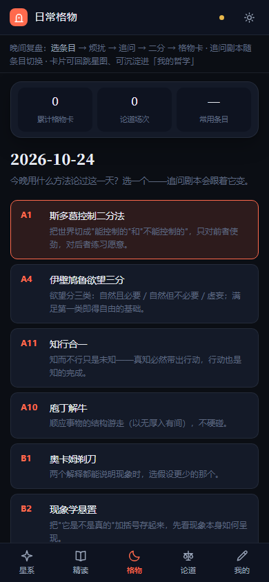
  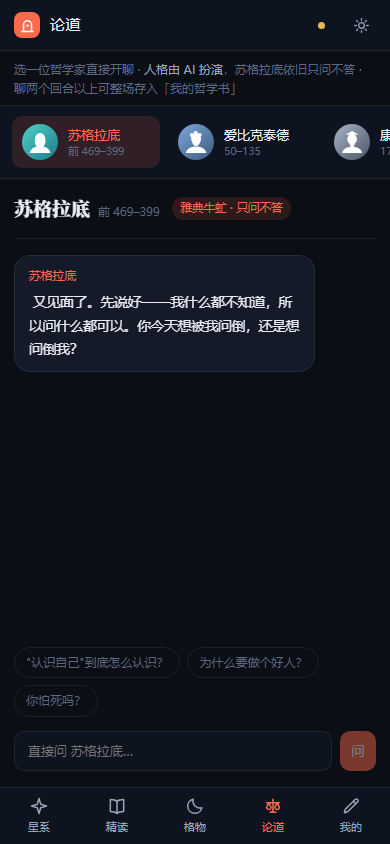
</p>
<p>
  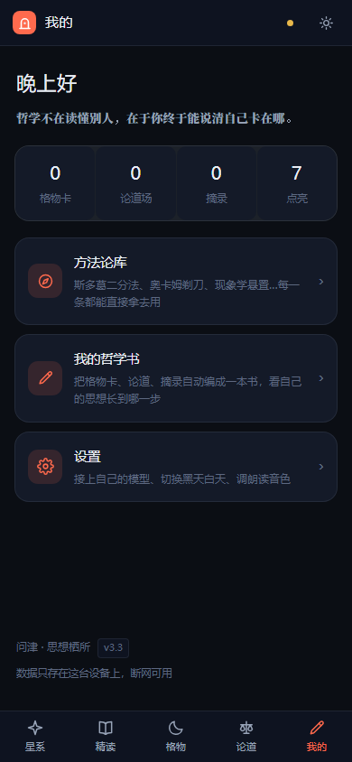
  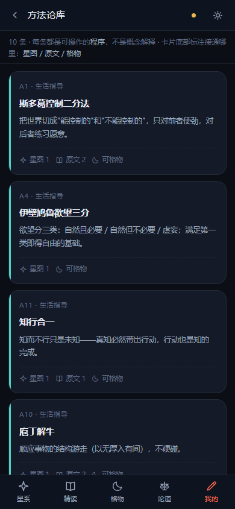
  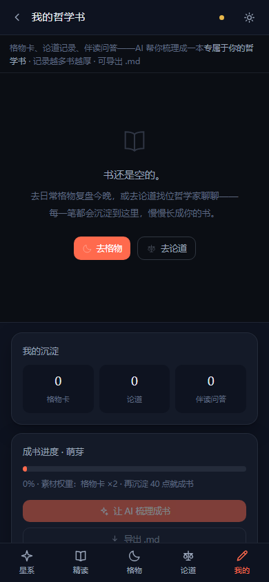
  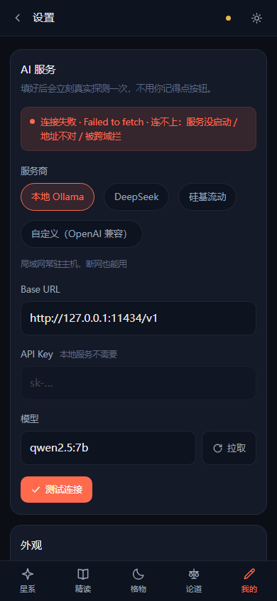
</p>

---

## 为什么重构

不是因为「HTML 不够好看」，是因为单文件版本已经无法安全维护了。两组数据：

**两端各有一份完整副本，逻辑已经漂移**

| | 电脑端 v2.1 | 手机端 v2.1 |
|---|---|---|
| 文件体积 | 134,880 字符 | 118,293 字符 |
| 内联 JS | 84,933 字符 | 81,856 字符 |
| 函数数 | 120 | 116 |

两端 **92 个同名函数里有 62 个实现已经不一致**——`testConnection`、`applyTheme`、`draw`、`gotoNode`、`debateSend` 全在列。

v2.1 修「配置了 API 还是走预置剧本」时，四个根因里有三个（内存布尔、`saveSettings` 无条件清零、`provider`/`primary` 不联动）都是**两端各打一遍补丁**才补全的。改一处忘一处的成本，已经超过重写本身。

**没有地方放抽象**

1200 行内联 `<script>` 里：

- 星图的力导向算法和 SVG 元素创建、指针事件、面板 HTML 拼在同一个函数里 → 算错了没法测
- AI 错误处理是 UI 函数里的一串正则 `aiHint()` → 想复用就得把 DOM 拖进来
- 全局 `settings` 对象被 30 多个函数直接读写 → 不知道谁会改它

---

## 现在长什么样

```
wenjin/
├── packages/
│   ├── core/          领域模型、数据、存储、AI、星图、格物、朗读、成书。不含 UI。
│   │   └── src/
│   │       ├── types.ts           所有领域类型
│   │       ├── prompts.ts         全部 system prompt（旧版散在 6 处）
│   │       ├── data/              10 组内置数据（从 v2.1 机械抽取）
│   │       ├── storage/           StorageAdapter + 可见错误的键值仓库
│   │       ├── settings/          设置仓库 + 脏数据归一化
│   │       ├── ai/                客户端 / 错误模型 / 接入门禁
│   │       ├── star/              星图物理引擎（纯函数）
│   │       ├── gewu/              格物状态机
│   │       ├── debate/            论道会话
│   │       ├── reader/            书架、切段、阅读进度
│   │       ├── tts/               三引擎朗读控制器
│   │       ├── materials/         沉淀库 + 成书结构
│   │       ├── progress/          点亮进度
│   │       ├── io/                导出文件
│   │       └── theme/             主题切换与持久化
│   ├── ui/            设计 token、通用组件样式、36 个图标 symbol
│   └── app/           七个视图 + 跨视图导航 + 依赖注入（两端共用）
├── apps/
│   ├── desktop/       Vue 3 + Vite + Electron，左侧竖排导航，可打包 exe
│   └── mobile/        Vue 3 + Vite + Capacitor，底部五格导航，可打包 apk
└── scripts/           数据/图标抽取、手机端截图、Android 图标生成
```

**分层约定**：`core` 不认识 Vue、不认识 Electron、不认识 Capacitor。`app` 认识 Vue 但不认识运行壳。只有 `apps/*` 知道自己跑在哪儿。

---

## 快速开始

```bash
npm install          # Node ≥ 20.19
npm test             # 146 个单测，约 2.4 秒
npm run typecheck    # core + desktop + mobile 全量类型检查
npm run dev:desktop  # 电脑端开发（vite dev server）
npm run dist:desktop # 打包便携版 exe

cd apps/mobile
npm run dev          # 手机端开发（同一局域网可用手机直连预览）
npm run build        # 产出 www/
npx cap sync android # 同步到 Android 工程
npm run apk          # 编译 debug apk
```

单跑某个包：

```bash
npm run build --workspace @wenjin/desktop
npx vue-tsc -p apps/desktop/tsconfig.json
```

---

## 已经解决的老问题

每一条都有对应的单测（`packages/core/src/**/*.test.ts`），跑 `npm test` 即可验证。

### AI「配了还是走简单反射」

| 旧版根因 | 现在的解法 |
|---|---|
| `aiVerified` 是纯内存布尔，重启即丢 | 改用**配置指纹**（主力+BaseURL+Key+模型），持久化到磁盘 |
| `saveSettings()` 无条件清零接入状态 | 设置变更携带 `changed` 字段，只有 AI 相关字段变了才重新验证 |
| 只有手动点「测试连接」才置真 | 启动补验 + 输入框失焦补验 |
| 设置页写 `provider`、调用链读 `primary` | `SettingsStore.setProvider()` 强制同步，架构上不给分家的机会 |
| `testConnection` 只 `GET /models` | 改成真发一次 `POST /chat/completions` |
| 缺 Key 的兜底服务盖掉真实错误 | 链路构造前先过滤不可用服务 |
| 401/403 不撤销接入状态 | `AiError.isAuthFailure` + `gate.clear()` |

### 重构过程中新发现的 bug

1. **星图节点上下拖不动**（已有单测）
   `tick()` 里写的是 `if (n.fx != null) { n.x = n.fx }` —— 只把 x 钉到拖拽位置，y 既没赋值也没积分。横轴会动，所以看起来「能拖」，纵轴其实一直是死的。

2. **「反对」关系从来没显示成红色**
   CSS 写 `var(--star-edge-opposes)`，变量定义叫 `--star-edge-oppose`（少一个 s）。变量不存在 → 回落到默认灰色。

3. **TTS 连点会叠音，停止停不干净**（已有单测）
   `ttsReading` 是全局布尔，两段音频可能同时在播。现在用「代际序号」作废过期回调；Edge 合成期间切书、点停止，回来也不会念出上一本的内容。

4. **点亮的概念刷新即丢**
   `let litNodes = [...]` 是纯内存数组，重启退回初始七个。现在落 `wj_lit`。

5. **格物剧本走完后的兜底卡内容空洞**
   没有预填文案的条目，旧版卡片写「已记录于追问对话」，等于什么也没给。现在从对话与二分归类里拼出真实的烦扰/可控/不可控。

6. **首次启动塞演示数据**
   旧版会灌 3 张格物卡、1 场论道、1 条伴读问答，侧栏还写死「连续 3 天 / 7 张卡」。用户看到的是自己从没做过的记录。现在首次启动是干净的。

### 3.1 手机端补上的东西

两端视图共用之后，窄屏问题一次改完两边都受益。这些是 390px 宽的真机上必然会踩的：

| 问题 | 原因 | 解法 |
|---|---|---|
| 方法论库卡片被压扁、内容裁掉 | `.m-card` 是 `overflow: hidden` 的 grid item，自动最小尺寸被解析成 0，十行挤在一个定高容器里就互相压 | 显式 `grid-auto-rows: max-content` |
| 星图挤成左边一条缝 | 右栏固定 296px，390px 的屏被吃掉四分之三 | 窄屏改成底部滑出层，点节点弹出、点把手收起 |
| 星图节点点不中 | 视野按 680×540 的宽屏比例铺，概念节点直径只剩 11px | 窄屏视野等比收窄，节点视觉尺寸放大到可点 |
| 手机上不能缩放星图 | 只监听了 `wheel` | 补双指缩放（两指中点作锚点，比值取倒数） |
| 阅读器三栏在手机上没法读 | 200px 书架 + 正文 + 320px 伴读栏 | 窄屏「一次一栏」，顶部三段切换 |
| 格物条目列表压住下面的统计卡 | 主区溢出但不滚动 | 窄屏给 `.main` 加 `overflow-y: auto` |
| 顶部提示条占三行 | 提示文案是给宽屏写的 | 窄屏按行高精确限高两行；用 `max-height` 而不是 `-webkit-line-clamp`（后者算出的盒高比两行矮，末行会被切掉半截） |

### 3.2 这一版收的尾

3.1 把两端共享层立起来之后，剩下的都是「只看截图发现不了、真机用手指才发现」的问题：

| 问题 | 原因 | 解法 |
|---|---|---|
| 星图 27 个名字糊成一团 | 宽屏画布散得开，390px 里必然互相压字 | 窄屏只留「已点亮 / 选中 / 悬停」三种标签，其余只画点；名字点开面板照样看得到，HUD 里写明「点节点看名字」 |
| 最外侧节点的名字被切掉半个字 | 视野缩放只按节点云算，没把标签宽度算进去（节点云 380 单位 + 两侧标签 ≈ 440 单位要装进 390px，`k=0.62` 时内容占 407px） | `k` 收到 0.7，内容占 360px，左右各留 15px |
| 圆点手指点不准 | 概念节点直径十来像素，命中区就等于视觉区 | 每个节点垫一个 +11 单位的透明命中圈（`fill: none` 必须显式 `pointer-events: all` 才有命中区） |
| 设了 `ELECTRON_RUN_AS_NODE` 的机器上双击 exe 没反应 | 自愈代码用 `process.execPath` 重启，而便携版那个路径在临时解压目录里；父进程一退出，便携启动器就把临时目录删了，刚拉起来的子进程连文件都没了 | 便携版改从 `PORTABLE_EXECUTABLE_FILE`（用户双击的那个原始 exe）重来一遍，并去掉内部 asar 入口参数 |
| 顶部提示条第二行仍被切半截 | 全局 `box-sizing: border-box`，`max-height` 把上下 padding（9+8=17px）也算进去了 | `max-height: calc(3.2em + 17px)` |

### 3.3.1 手机端功能修复

真机上发现 3.3.0 的 apk 有一大片功能用不了，两个根因都在环境层，不在业务代码：

| 现象 | 根因 | 修法 |
|---|---|---|
| 伴读问答、论道、AI 梳理、拉模型列表全废 | 手机 WebView 强制同源策略，DeepSeek / SiliconFlow 不带跨源头；电脑端没事是因为 Electron 里 `webSecurity: false` | AI 请求在真机上改走 `CapacitorHttp` 原生通道（`apps/mobile/src/capFetch.ts`），浏览器 dev 模式自动落回标准 fetch |
| 局域网同步连不上电脑、TTS 桥没声音 | Android 9+ 默认禁止明文 HTTP，同步（`:47800`）和 TTS 桥（`:8787`）都是 `http://` | 清单声明 `android:usesCleartextTraffic="true"`；TTS 桥补 CORS 中间件 |

另外：同步服务端口被占时自动顺延（最多 +5），设置页显示的是真实监听端口。

### 3.3 两端数据终于通了

**1. 格物页不再是「上下两块屏」**

窄屏下原来是「上面 main 自己滚、下面 side 固定 34vh 自己滚」——一块屏里两条滚动条，手指落在哪个区域滚哪个，看起来像被硬切开的两截。现在把滚动权收归 `.wrap`：`display: block` + `overflow-y: auto`，main / side 都不再各自滚；统计压成一行，历史格物卡默认收起（标题右边一个 `N 张 · 展开` 的胶囊钮）。

**2. 局域网同步（新增）**

两端各存各的数据一直是这个应用的短板：换台机器就得靠手动导 JSON。3.3 起同一 Wi-Fi 下可以直接搬：

| 角色 | 做什么 |
|---|---|
| 电脑端 | 主进程起一个小 HTTP 服务（`0.0.0.0:47800`），设置页把你的内网地址亮出来，可一键复制 |
| 手机端 | 设置 → 局域网同步 → 填地址 → 测试 / 从电脑拉取 / 推送到电脑 |

```
GET  /wj/ping      → 报活：设备名、版本、对面有多少格物卡和藏书
GET  /wj/snapshot  → 整机快照（电脑端渲染进程每 2s 用指纹比对，有变化才推给主进程）
POST /wj/snapshot  → 手机推上来的快照，主进程转给渲染进程落盘并重载
```

几个刻意的取舍：

- **不做自动双向合并**。格物卡、论道、阅读进度都是追加型且带先后语义的数据，两边各改一半后靠 id 求并集，冲突了没法判断谁对；猜错的表现就是「我的记录怎么少了」。所以只做整包覆盖，方向由用户点。
- **覆盖前一律自动备份**（`wj_backup_<时间戳>`，保留最近 3 份）。备份键和连接地址被列为本机专有键，不跟着快照走，否则会把对面的本机地址覆盖过来。
- **快照要过校验**：`app` 标记、版本号、值必须是字符串、总量 ≤ 12MB。这挡不住同局域网的恶意请求，但能防止一段乱数据把本机存储写坏——写坏了用户是真的会丢记录。
- 落盘后**整页重载**而不是逐个 store 通知：设置、藏书、格物卡分别缓存在不同 store 里，逐个通知极容易漏，重载只花几百毫秒但绝不会显示旧数据。

---

## 迁移进度

| 视图 | 电脑端 | 手机端 |
|---|---|---|
| 概念星系 | ✅ 引擎 23 条单测 | ✅ 含双指缩放 |
| 精读伴读 | ✅ 划词三问、段落朗读、载入书籍 | ✅ 三栏折叠 |
| 方法论库 | ✅ 详情弹层与三处跳转 | ✅ |
| 日常格物 | ✅ 状态机 17 条单测 | ✅ |
| 论道 | ✅ 六位哲人，人格独立 | ✅ 哲人横滑条 |
| 我的哲学 | ✅ 成书结构 14 条单测 | ✅ |
| 设置 | ✅ AI 状态带与拉取模型 | ✅ |
| TTS 三引擎 | ✅ 10 条单测（含并发） | ✅ |
| 自定义书籍导入 | ✅ | ✅ |
| 格物卡 / 哲学书导出 | ✅ | ✅ |
| 局域网同步 | ✅ 服务端（47800 端口） | ✅ 拉取 / 推送 |
| 星图共建（3.5.0） | ✅ AI 规范化 + 手动填写 | ✅ |

**数据兼容**：设置、藏书、阅读进度、格物卡全部沿用 v2.x 的原存储键名（`wj_settings_v1` / `wj_user_books` / `wj_prog_*` / `wj_materials_v1` / `wj_ai_sig`），升级后老数据直接读得到，不需要迁移逻辑。

---

## 数据来源

`packages/core/src/data/*.ts` 与 `packages/ui/src/WenjinSprite.vue` 由 `scripts/` 下的脚本从 v2.1 机械抽取，保证内容逐字一致。

改数据请改生成后的 `.ts` 文件，**不要回改 HTML** —— 那份已经归档为只读基准，只用于迁移期对账。

---

## 版本沿革

- **3.5.0（2026-10-24）**：星图共建——用户可向星图添加自定义概念/人物/关系，AI 把自然语言描述规范化成校验过的星图片段（预览确认才入库）；自定义节点可删、可点亮、参与盲区统计。
- **3.4.0（2026-10-24）**：内容大扩充——内置书库 2→6 本（新增《道德经》《论语》《逍遥游》《大学》原典节选），论道哲人 6→8 位（新增老子、孔子），星图 25→28 节点，离线导读覆盖新书。
- **3.3.2（2026-10-24）**：修掉手机端精读伴读用不了的三道锁（划词 selectionchange、自动切伴读栏、朗读按钮常显、引文丢失 bug）。
- **3.3.1（2026-10-24）**：修掉手机端 AI 全废的两个环境层根因（WebView 同源策略 → 原生通道；Android 明文 HTTP → manifest 声明）。
- **3.3（2026-10-24）**：局域网双端互通 + 格物页手机端重排。
- **3.2（2026-10-24）**：星图标签降噪、命中圈、便携版自愈路径。
- **3.1 及以前**：见提交历史。

## 许可

GPL-3.0-or-later
