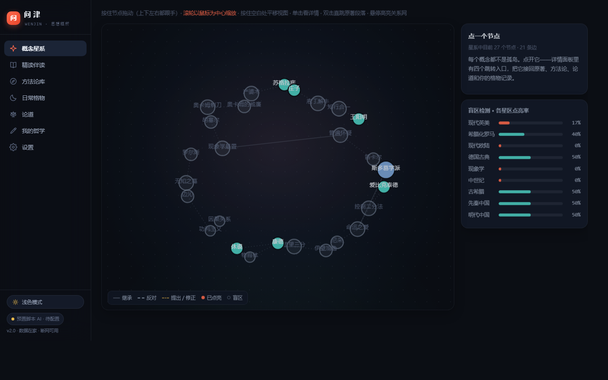
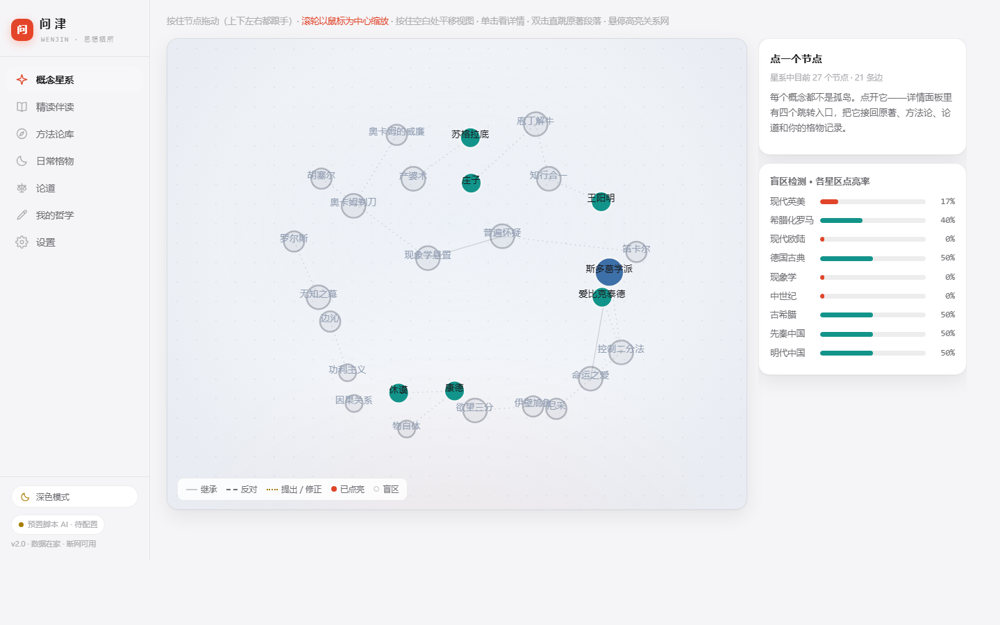
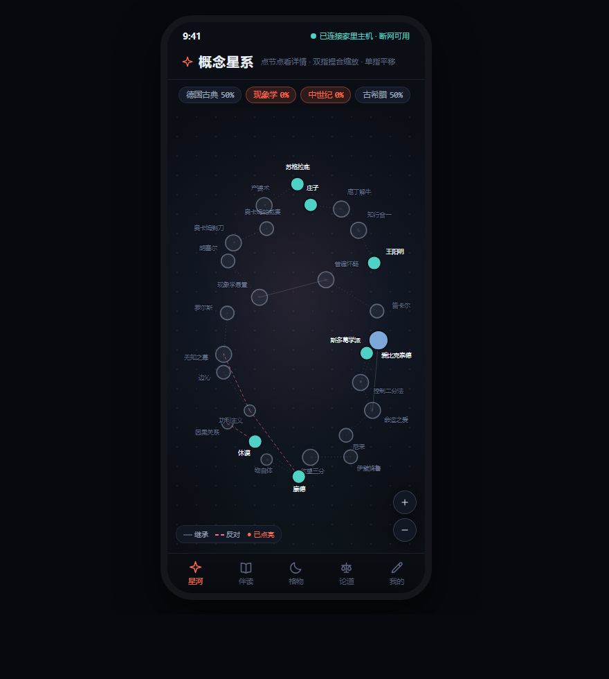
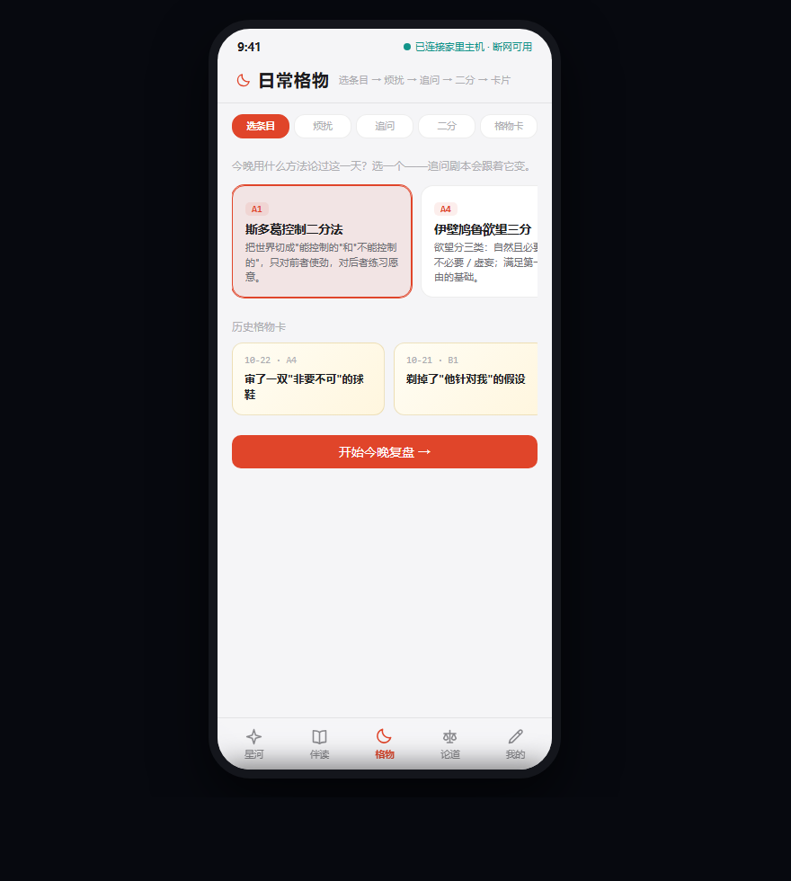

# 问津 · WenJin

> **一个现代人的思想栖身之所。**
> 它不做哲学百科，它是一座思维训练场 —— 数据在家，断网可用，AI 按需接入。

<p>


</p>

---

## 目录

| | |
|---|---|
|  |  |
| **黑天** · 星图在深空里发光 | **白天** · 苹果式灰底纸卡 |
|  |  |
| **手机端黑天** · 竖屏单指平移 | **手机端白天** · 格物卡仪式感 |

---

## 为什么做这个

读过哲学的人大概都遇到过这三件事：

1. **读不懂，没人问。** 啃《存在与时间》卡在第三页，书不能回答你。搜索引擎给的是论文，不是对话。
2. **读完了，用不上。** 知道了斯多葛二分法，可第二天被生活怼的时候，脑子里一片空白。
3. **读多了，串不起来。** 尼采反对的是谁的什么？海德格尔从哪儿接的？脑子里是一堆孤立的名字。

问津针对的就是这三件事，用三个动作回答：**读的时候能问 → 遇事的时候能练 → 想法自己长成网。**

并且它是一条**单文件、零依赖、不联网也能跑**的路 —— 你的思考记录不该锁在任何人的服务器里。想用 AI？自己填 API，本地 Ollama 也行。

---

## 七个栏目，全部双向联通

| 栏目 | 干什么 |
|---|---|
| **概念星系** | 27 个概念节点的关系图谱。拖节点、缩放、抓手平移。点节点直接跳到对应原著段落 / 方法论 / 论道 / 格物记录 —— 不是装饰图，是导航 |
| **精读伴读** | 读原著（可载入自己的 `.txt` / `.md`）。划一段就能三问，可换 Edge 神经网络音色朗读 |
| **方法论库** | 10 条可直接执行的程序（SOP + 常见误用），每条都能一键带进格物 |
| **日常格物** | 晚间复盘四步闭环：选条目 → 写烦扰 → 三轮追问 → 二分 → 生成格物卡 |
| **论道** | AI 扮演六位哲学家，各按各的路数说话。苏格拉底只问不答。聊完存进哲学书 |
| **我的哲学** | 格物 / 论道 / 伴读的沉淀，AI 梳理成专属于你的书，可导出 Markdown |
| **设置** | 自己的 API、朗读引擎、双主题、数据备份 |

---

## 双主题

两套**独立配色**，不是简单反色：

- **黑天（默认）**：深夜壳 `#0B0E14`。星图在深空里发光，唯独读书的纸卡留一盏暖灯 —— 长时间阅读不刺眼
- **白天**：苹果式 `#F5F5F7` 灰底 + 纯白卡片 + hairline 细边。教室、户外看也不反光

切换即时生效并记住选择。星图的节点、连线、标签、图例跟着主题一起换色。

### 关于质感

按苹果的设计语言重做：

- 双层柔和投影（一层薄描边 + 一层大范围弥散），卡片真的浮起来
- 弹层、状态栏、底部 Tab 用毛玻璃（backdrop blur + saturate）
- SF 字体栈、iOS 一体式分段控件
- 统一缓动 `cubic-bezier(.32,.72,0,1)`
- **29 个图标全是自绘 SVG**（SF Symbols 风格：1.8 描边、圆头圆角、跟随文字色），一个 emoji 都没有 —— 不会在 Windows 上被彩色 emoji 字体搞成花脸

---

## 快速开始

### 方式一：直接下打包好的（最省事）

到 [Releases](../../releases) 下载：

- `wenjin-desktop-x.x.x.exe` —— Windows 单文件，**双击即用**，不需要 Python / Node / 任何环境。首次启动要自解压约 100MB 到临时目录（10 秒左右），之后秒开
- `wenjin-mobile-x.x.x.apk` —— 安卓安装包。系统提示「未知来源」时允许安装

### 方式二：浏览器里直接跑（零构建）

```bash
git clone https://github.com/hillen24/wenjin.git
cd wenjin
```

双击 `src/wenjin-desktop.html` 或 `src/wenjin-mobile.html` —— **这就是完整的应用**，单文件，无外部依赖。

> 数据存在浏览器 localStorage 里。想换设备就用「设置 → 数据管理 → 导出全部数据」搬。

### 方式三：自己构建

**电脑版（Electron）**

```bash
cd desktop
npm install
npm run start        # 开发预览
npm run dist         # 打成单文件 exe → dist/
```

**手机版（Capacitor）**

```bash
cd mobile
npm install
npm run add:android  # 首次生成 android/ 工程
npm run sync
npm run open         # 用 Android Studio 打开，构建 apk
```

改界面只需要改 `src/*.html`，然后同步到 `desktop/www/index.html` 和 `mobile/www/index.html`（这两个是构建时的真正入口）。

---

## 接上 AI（可选）

**不配也能用。** 内置预置剧本保证七个栏目全部可走通，不会因为没 API 就变成砖。

想接真模型：**设置 → AI 服务**

1. 选服务商，填 Base URL 和 API Key（只存本机，不上传）
2. 点 **拉取** —— 自动读服务端模型列表
   - OpenAI 兼容 → `GET {BaseURL}/models`
   - Ollama → `GET {BaseURL}/api/tags`
   - 拉回来直接下拉选，拉不到可手填
3. 点 **测试连接**，真发一次请求。侧栏底部绿点 = 真 AI 已接入，黄点 = 预置脚本
4. 接入后所有环节走真模型；**任何一环失败自动降级回预置剧本**，功能不断

推荐配置：

| 服务 | Base URL | 模型 |
|---|---|---|
| 本地 Ollama（推荐，断网可用） | `http://127.0.0.1:11434/v1` | `qwen2.5:7b` |
| DeepSeek | `https://api.deepseek.com/v1` | `deepseek-chat` |
| 硅基流动 | `https://api.siliconflow.cn/v1` | 任意 |

主力服务挂了会自动走兜底服务（设置里可配）。

### 朗读换成自然人声

浏览器内置语音偏机械。想要微软神经网络音色（晓晓 / 云希 / 陕西话晓妮）：

```bash
pip install edge-tts fastapi uvicorn
python scripts/edge-tts-bridge.py
```

脚本会打印局域网地址（如 `http://192.168.1.5:8787/v1`），填进「设置 → 阅读与朗读 → Edge-TTS」即可。连不上自动退回系统音。

---

## 设计上几个不太显眼但重要的决定

- **哲学家不是同一个 AI 换皮。** 每位 150 字铁律系统提示，规定他只能从自己的概念体系说话。苏格拉底被禁止下结论 —— 他只能问。多轮对话历史一并下发，不会聊到第三轮就失忆。
- **星图标签会自己让路。** 27 个标签用放射式排布（按簇心反方向摆），贴边时自动翻转锚点。实测从 12 对重叠降到 2 对。
- **竖屏星图不压缩。** 视野尺寸按容器反算，1 单位 ≈ 1 CSS px，不会在 392px 宽的手机上被压成中间一条。
- **坏数据能自愈。** 设置里存了中文服务名之类的脏数据，读取时自动映射回合法 key，不会白屏。
- **没有云端。** 局域网内的设备可以互相当服务器（Edge-TTS 桥、Ollama），但问津自己不需要任何后端。

---

## 目录结构

```
wenjin/
├── src/
│   ├── wenjin-desktop.html    # 电脑端完整应用（单文件，可直接双击打开）
│   └── wenjin-mobile.html     # 手机端完整应用（移动形态，底部五 Tab）
├── desktop/                   # Electron 封装
│   ├── main.js
│   ├── package.json
│   └── www/index.html         # 构建入口（由 src 同步而来）
├── mobile/                    # Capacitor 封装
│   ├── capacitor.config.json
│   ├── package.json
│   └── www/index.html
├── docs/
│   ├── 使用说明.md
│   └── 设计说明.md
├── scripts/
│   └── edge-tts-bridge.py     # Edge-TTS 局域网桥（可选）
├── screenshots/
└── LICENSE
```

---

## 路线图

- [ ] 局域网实时同步（现在靠 JSON 备份接力）
- [ ] 概念图可自行增删节点、连边
- [ ] 格物记录的时间轴回看（"三个月前你在纠结什么"）
- [ ] 更多哲学家（目前六位：苏格拉底 / 柏拉图 / 尼采 / 海德格尔 / 萨特 / 加缪）
- [ ] 概念节点导出成 Anki 卡片

---

## 许可

**GNU General Public License v3.0** —— 详见 [LICENSE](LICENSE)。

你可以自由使用、修改、分发，甚至商用；但**分发衍生作品时必须同样以 GPL-3.0 开源**，并保留版权声明。这是有意的选择：思想工具不该被谁关起门来。

---

*问津不做哲学词典，做思维训练场。数据是你的，思考也是你的。*
